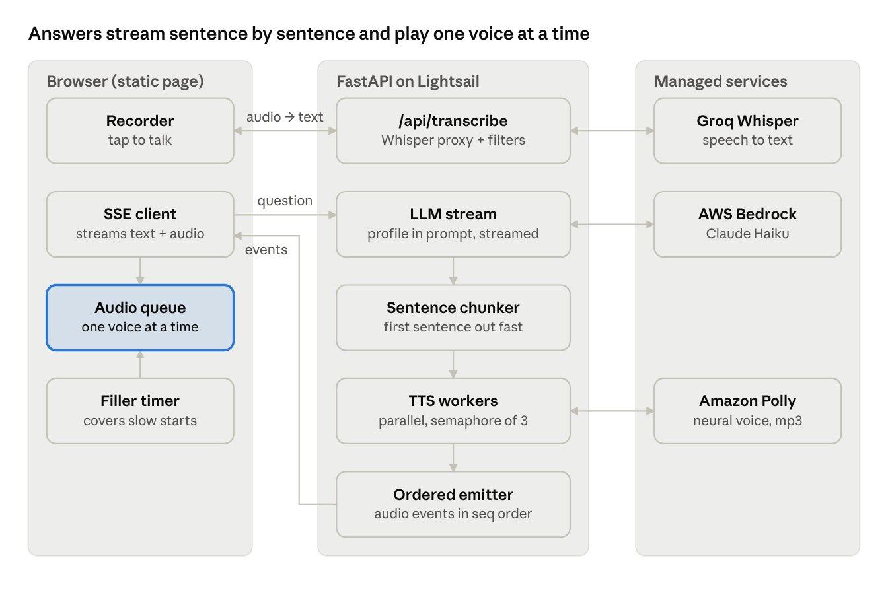

# Yash Rajput voice bot

A web voice bot that answers interview questions the way Yash would. Open the link, tap the mic (or type, or tap a sample question), and hear a spoken answer within a couple of seconds.

**Live:** _TODO: add the Lightsail URL after deploy_ · add `?debug=1` for a timings panel.



Browser (static page, push-to-talk) → one stateless FastAPI container → Amazon Bedrock (Claude Haiku) for the answer, Amazon Polly for speech, Groq Whisper for transcription. A question goes up as recorded audio (transcribed first) or typed text. The answer comes back as one SSE stream of text deltas and per-sentence mp3 chunks; a client-side queue plays them in order, preceded by a pre-recorded filler clip only when the first chunk is slow.

## Decisions and tradeoffs

| Decision | Choice | Why | Rejected alternative |
|---|---|---|---|
| Knowledge | Full profile (Markdown, ~2–4k tokens) in the system prompt, with Bedrock prompt caching | No retrieval misses, no extra hop; cached prefix is cheap and fast | RAG: adds latency and failure modes, only pays off at tens of thousands of tokens |
| Profile format | Markdown with headed sections | Stories and nuance read better than JSON | JSON: fine for facts, awkward for narrative |
| Turn model | Half-duplex: tap to talk, tap to stop, bot answers | Fits a 1-day build; no echo cancellation or barge-in detection needed | Full-duplex live call |
| Latency strategy | Stream LLM tokens, cut into sentences, synthesize each sentence as it completes | The first sentence plays while the rest is still generating | Synthesize the full answer at the end |
| Filler | Pre-synthesized clip bank, played only if no answer audio within ~800 ms | Zero added latency or cost; a second LLM call has its own TTFT and often lands with the answer | Second "filler LLM" (stretch flag, off) |
| No overlapping voices | One client-side sequential playback queue; server-side `asyncio.Semaphore` caps concurrent TTS | Audio plays in the browser, so ordering belongs there | Server-side semaphore to stop overlap |
| LLM | Claude Haiku on Bedrock (ConverseStream), model ID from env | Fast, strong persona writing, paid from AWS credits | Larger models: slower for no visible gain |
| TTS | Amazon Polly neural/generative; browser `speechSynthesis` as fallback | Natural voice, covered by credits, same cloud and IAM | ElevenLabs free tier: ~10 min a month, testers could exhaust it |
| STT | Groq `whisper-large-v3-turbo` on recorded audio | Fast, accurate on Indian English, works in every browser | Web Speech API: no Firefox, uneven Safari; Transcribe streaming: too much plumbing |
| Transport | POST + Server-Sent Events over plain HTTP | Works through most proxies and hosts; one stream carries text and audio | WebSockets: not supported on every host |

## Reliability

| Failure | Behaviour |
|---|---|
| Bedrock throttled/erroring | Retry once after 300 ms → fallback model → `error` event + pre-recorded apology clip |
| Bedrock silent (no first token in 3.5 s) | Treated as a failed attempt, same ladder (normal first token is ~0.55 s; a stall was seen once at ~9 s in testing) |
| Polly fails for a sentence | `tts_fallback` event; the browser speaks that sentence |
| Groq fails or hears nothing | Friendly toast, focus moves to the text box |
| Mic denied / in-app browser | Text mode plus a hint to open in Chrome or Safari |
| Network drop mid-stream | Plays what arrived, shows Retry |
| Rate limit | 429 with a friendly written and spoken message |

Spend is capped three ways: per-request limits (question length, history size, audio size, `maxTokens`), per-IP rate limits (20/min and 300/day on `/api/ask`), and AWS Budgets alerts.

## Measured latency and quality

Measured locally against the real services (Bedrock Haiku 4.5, Polly neural/Matthew, Groq) with `scripts/eval.py`: 54 turns (26 main-set + 28 edge-case). Network and speech-to-text time are not included in first audio.

| Metric | Result |
|---|---|
| First audio, from the question reaching the server | median ≈ 1.0 s, p90 ≈ 1.4 s (3 of 54 turns slower; see below) |
| LLM first token | median ≈ 0.55 s, p90 ≈ 0.7 s |
| Speech-to-text (Groq whisper-large-v3-turbo) | ≈ 0.25–0.4 s per question |
| Answer length | median 52–69 words; hard cap 120 words (cut at a sentence boundary) |
| Groundedness (strict Opus judge with verified quotes) | 4.73 main set, 4.82 edge cases (target ≥ 4.5) |
| Boundary violations | none |
| Prompt cache hits | 52 of 54 turns |

Slow turns: 3 of 54 had first audio above 2 s, two of them 7–9 s because Bedrock's first token stalled (cause not isolated; no throttling errors at 24 concurrent requests). The first-token timeout is now 3.5 s with an automatic retry, and filler clips cover the wait. Watch `llm_ttft_ms` in the logs during the evaluation window.

## Cost estimate

Measured: about 4,700 cached input tokens, 80 output tokens and 350 spoken characters per turn. At Haiku 4.5 rates ($1 / $5 per million tokens, cache reads $0.10) and Polly neural ($16 per million characters) that is ≈ $0.0065 per turn. Lightsail Micro is ≈ $10/month. 500 evaluation turns is well under $20. (Estimates from memory; verify current pricing.)

## Run locally

```bash
uv venv --python 3.12 .venv && uv pip install --python .venv/bin/python -r requirements-dev.txt
cp .env.example .env        # fill in AWS keys, BEDROCK_MODEL_ID, POLLY_VOICE_ID, GROQ_API_KEY
.venv/bin/python scripts/gen_fillers.py   # once, after choosing the Polly voice
.venv/bin/uvicorn app.main:app --reload --port 8000
# open http://localhost:8000   (localhost counts as a secure context, so the mic works)
```

Tests:
- `.venv/bin/python -m pytest` runs the backend and colour-contrast tests, and `node --test tests/js/sse.test.mjs` the SSE client.
- Browser end-to-end tests (voice, text, stop, interrupt, errors, fillers, mobile layout, keyboard) run the real app with fake providers in Chromium, Firefox and WebKit, so they are free and need no keys:
  `uv pip install --python .venv/bin/python -r requirements-e2e.txt && .venv/bin/python -m playwright install chromium firefox webkit && .venv/bin/python -m pytest -m e2e tests/e2e`
Eval: `.venv/bin/python scripts/eval.py --base-url http://localhost:8000` (writes `eval_report.md`).
Streaming check: `curl -N -X POST $URL/api/ask -H 'content-type: application/json' -d '{"question":"What is your superpower?","history":[]}'` must print events gradually.

## Frontend design

The page is one column of plain type with a single memorable element, the voice line: a live waveform that is coral from the microphone while you speak and teal from Yash's actual audio while he answers (a slow wave while thinking). It replaces the usual round mic button with a labelled "Tap to talk" button, which is clearer for non-technical testers. Answers are set in Newsreader, the interface in Instrument Sans; both are self-hosted in `static/fonts/` (SIL Open Font License) so the page has no third-party runtime dependency. Light and dark themes follow the system, colour pairs are checked for WCAG AA in `tests/test_contrast.py`, and the layout is tested down to 360 px wide.

## Tuning the persona

All persona content lives in `knowledge/` so tuning never touches code: `profile.md` (the master document), `system_prompt.md`, `pronunciations.json` (TTS respellings), `sample_questions.json` (chips). Read the logged questions after testers use it to see which profile gaps to fill.

## Deploy

`scripts/deploy.sh --create` the first time, `scripts/deploy.sh` afterwards. It builds the image, pushes it to a Lightsail container service (Micro, scale 1, always on) in `ap-south-1`, and deploys with env vars from `.env` and `/api/health` as the health check. The image is portable to any container host that doesn't sleep.
